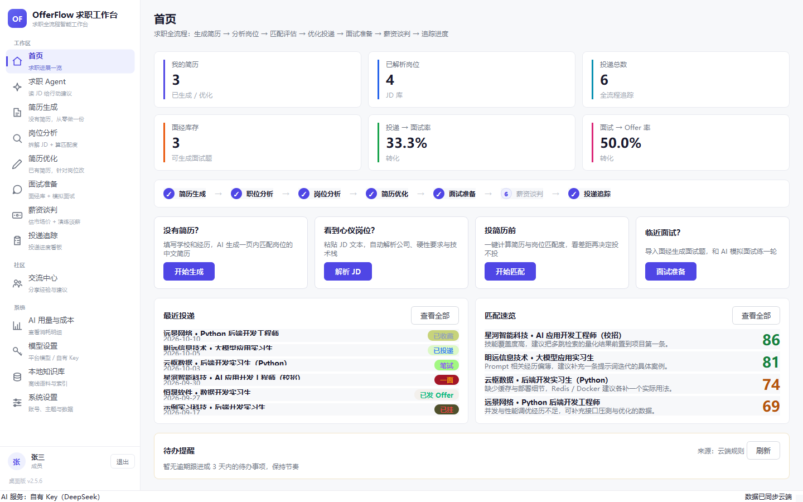
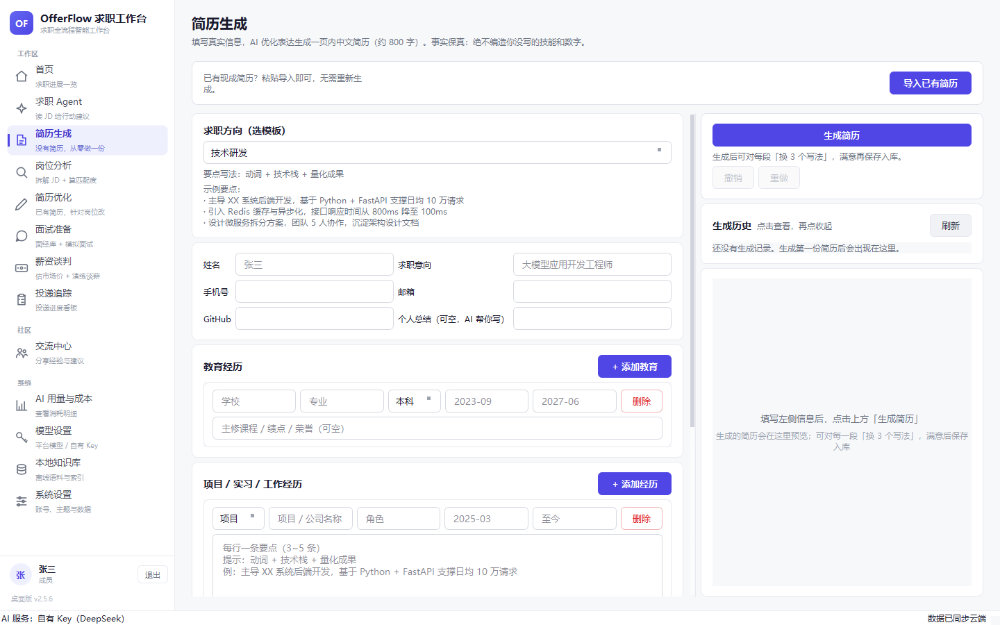
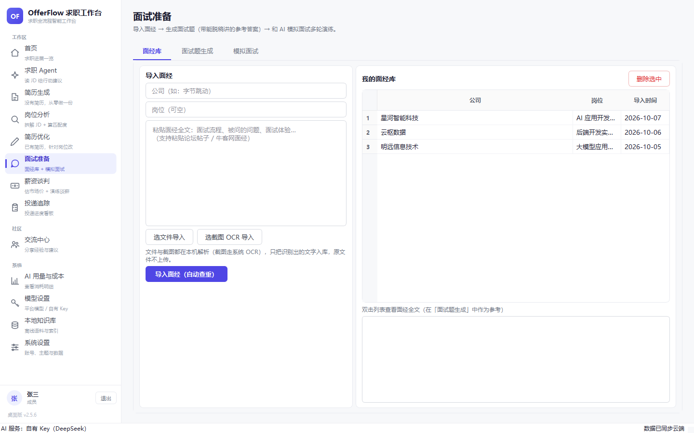
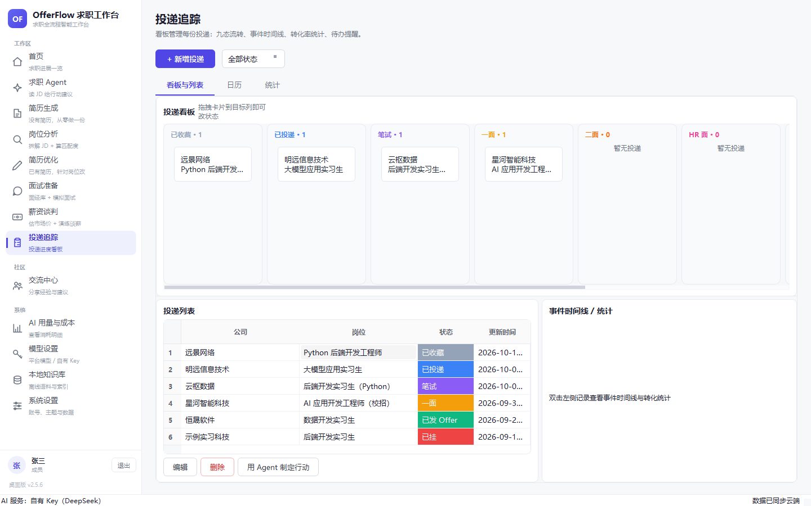
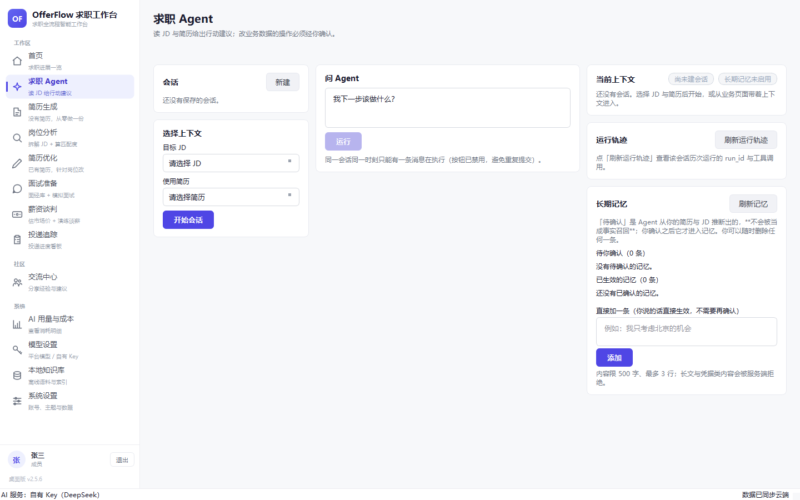

<div align="center">



<h1>OfferFlow</h1>

<p><b>求职全流程 AI 工作台</b><br>
JD 解析 → 简历生成 / 优化 → 岗位匹配 → 模拟面试 → 薪资谈判 → 投递追踪<br>
每一步都有 AI 参与，但<b>改数据前必须人工确认</b></p>

<p>
  <a href="#快速开始">快速开始</a> ·
  <a href="#功能">功能</a> ·
  <a href="#界面一览">界面</a> ·
  <a href="#三端架构">架构</a> ·
  <a href="#设计取舍为什么这么做">设计取舍</a> ·
  <a href="#参与贡献">参与贡献</a>
</p>

<p>
  
  
  
  
  
  
  
</p>

</div>

---

## 为什么要做这个

求职工具大多是「单点」的：一个改简历的网站、一个记投递的表格、一个刷题 App。真实流程却是串起来的，而且**最容易出错的地方是 AI 替你写内容**——编造一段你没做过的项目、把「3 年」写成「5 年」，你带着假简历去面试。

OfferFlow 的两条设计主线就是冲着这两点来的：

1. **全流程串联**：上一环节的产物直接成为下一环节的输入，不用来回复制粘贴（岗位库 → 简历 → 匹配 → 面试题 → 薪资区间 → 投递看板）。
2. **事实保真优先**：所有 AI 产出都要过一遍「可溯源」校验——简历里没写过的数字、技能、证书会被拦下或标红；改业务数据（如投递状态）走 **LangGraph `interrupt()` 暂停 → 用户确认 → 才写库**，拒绝或超时就一个字节都不改。

---

## 功能

| 模块 | 说明 |
|---|---|
| **简历生成** | 结构化卡片输入 → 一页内中文简历；字数硬约束；**事实保真校验**（编造的技能/证书/联系方式会标红）；逐段「换 3 个写法」多候选 |
| **简历优化** | 差距分析驱动的整份重写；硬事实（邮箱/电话/年份/关键词）不丢失，否则**回退原文**；一页约束裁剪；前后 diff；多版本 |
| **岗位分析** | JD 粘贴或**文件导入**（PDF/Word/文本，本地解析）+ **截图 OCR**；提取公司/硬性要求/隐藏信号；本地技能词典 + JD 结构化需求混合评分出匹配度与缺口 |
| **面试准备** | 面经库（相似度 ≥ 0.9 自动查重）；出题（技术/项目/行为，带参考答案 + **疑似编造数字标记**）；多轮模拟面试，逐题点评 + 总结 |
| **薪资谈判** | 市场价按「学历 × 方向 × 城市 × 经验」**规则表**计算（数字不由 AI 编），给出**开口价/目标价/底线价三档** + AI 解读；谈判演练 4 场景，AI HR 压价，教练每轮点评 |
| **投递追踪** | 九态看板（收藏→投递→笔试→一面→二面→HR面→Offer→接受/已挂）、事件时间线、转化率统计、逾期/面试提醒 |
| **求职 Agent** | 读 JD/简历/匹配结果 → 产出结构化决策（`apply_now` / `optimize_first` / `collect_evidence` / `wait` / `skip`）+ 带证据引用的建议；**改数据必须确认**；长期记忆（推断的偏好先落 `proposed`，确认后才生效并被召回） |

---

## 界面一览

以桌面版为例（截图内为虚构演示数据）：

| 简历生成 · 结构化输入 + 逐段多候选 | 模拟面试 · 面经库 + 出题 + 演练 |
|---|---|
|  |  |

| 投递追踪 · 九态看板 + 转化率 | 求职 Agent · 决策建议 + 长期记忆确认 |
|---|---|
|  |  |

---

## 三端架构

```
                    ┌──────────────────────────────────────────┐
                    │           客户端（三端同源）              │
                    ├────────────┬─────────────┬───────────────┤
                    │  桌面版     │   网页版     │   手机版       │
                    │  PySide6   │  React 19   │  Android      │
                    │  Qt 6      │  + Vite     │  WebView 壳    │
                    └──────┬─────┴──────┬──────┴───────┬───────┘
                           │            │              │
                           │  Bearer    │   /api/v1/*  │  加载网页
                           ▼            ▼              ▼
                    ┌──────────────────────────────────────────┐
                    │     后端  FastAPI (uvicorn :8001)        │
                    │  auth · jd · resume · match · interview  │
                    │  salary_negotiation · application · …    │
                    │                                          │
                    │  求职 Agent（LangGraph）                  │
                    │  只读工具 → 决策 → 提议写 → interrupt()   │
                    │            → 用户确认 → 才真正写库        │
                    └───────┬──────────────────────┬───────────┘
                            │                      │
                    ┌───────▼────────┐    ┌────────▼────────┐
                    │ PostgreSQL 16  │    │  ChromaDB       │
                    │ 业务数据 +      │    │ 语义检索 /       │
                    │ Checkpointer   │    │ 长期记忆向量     │
                    └────────────────┘    └─────────────────┘

   桌面版额外自带【本地 AI 层】（离线可用，BYOK，不经服务端）：
     fastembed(bge-small-zh) 向量索引 · Windows 系统 OCR · 文档解析 · 本地知识图谱
```

**关键点**：写工具（如 `application.update_status`）**不出现在模型的 function-calling 清单里**，只能走「先落 `ActionIntent` → `interrupt()` 暂停 → 用户确认 → `execute_write_action`」这条路。所以模型再"想写"也写不动数据。

---

## 快速开始

### 网页版（推荐先跑这个）

```bash
cd web
cp .env.example .env          # 填 DEEPSEEK_API_KEY（其余可先留默认）
docker compose up --build
```

打开 <http://localhost>。后端在 `:8001`，健康检查 `curl http://localhost:8001/api/health`。

> 不想用 Docker 也可以：`pip install -r web/requirements.txt && python web/run.py`（SQLite，无需 Postgres），前端另起 `cd web/frontend && npm install && npm run dev`。

### 桌面版

```bash
cd desktop
python -m venv .venv
.venv\Scripts\pip install -r requirements.txt      # Windows
# source .venv/bin/activate && pip install -r requirements.txt   # macOS / Linux
.venv\Scripts\python main.py
```

首次启动后到 **模型设置** 填 LLM Key（BYOK）。桌面版默认连本机后端 `http://localhost:8001`，可用环境变量 `OFFERFLOW_CLOUD_URL` 指向自建部署；五大 AI 能力默认本地跑，本地模型不可用时才回落云端。

> **首次运行注意**：向量检索用的中文 embedding 模型（`bge-small-zh-v1.5`，约 90 MB）不随仓库分发，首次走向量检索时由 `fastembed` 自动下载到本地缓存。想离线预置，可在联网环境提前跑一次。

### 手机版（Android）

```bash
cd android
echo "sdk.dir=/path/to/Android/Sdk" > local.properties
gradle assembleRelease
```

手机版是 WebView 壳，在线时直接加载网页版——**网页一更新，手机端立刻同步**，壳本身基本不用重发。

---

## 目录结构

```
offerflow/
├── desktop/          # PySide6 桌面工作台（含本地 AI 能力）
│   ├── offerflow_desktop/
│   │   ├── core/         # 生成守门层、事实保真、排版、技能词典…
│   │   ├── services/     # 简历生成/优化、面试、薪资谈判、语义检索
│   │   ├── local_ai/     # 向量索引 + 知识图谱 + 本地记忆
│   │   └── ui/pages/     # 各功能页面
│   ├── tests/            # 含反向对照（变异测试）脚本
│   └── docs/模板预览/     # 导出效果示例
├── web/              # FastAPI 后端 + React 前端
│   ├── backend/app/
│   │   ├── core/         # LLM / 向量库 / 并发 / 薪资基准…
│   │   ├── modules/      # 业务模块（resume / interview / salary_negotiation / career_agent…）
│   │   └── agents/graphs/# LangGraph 图定义
│   ├── frontend/         # React 19 + Vite + TS
│   └── docker-compose.yml
└── android/          # Android WebView 壳
```

---

## 技术栈

| 层 | 选型 |
|---|---|
| 桌面 | Python 3.11 · PySide6 (Qt 6) · fastembed (bge-small-zh) · QtPdf |
| 网页前端 | React 19 · Vite · TypeScript · Tailwind · Zustand · Recharts |
| 后端 | FastAPI · SQLAlchemy 2.0 · Pydantic v2 · Uvicorn |
| Agent | LangGraph 1.2 · langgraph-checkpoint-postgres · psycopg v3 |
| 数据 | PostgreSQL 16 · ChromaDB · SQLite（本地副本） |
| 部署 | Docker Compose（nginx 反代） |
| 手机 | Android SDK 34 · Gradle 8.7 · WebView |
| 模型 | 任意 OpenAI 兼容接口（BYOK）——DeepSeek / OpenAI / Moonshot / 自建 |

---

## 测试

```bash
# 桌面版
cd desktop && .venv/Scripts/python tests/run_all.py

# 网页版后端
cd web && pytest backend/tests/ -q
```

桌面版的 `tests/_mutate_*.py` 是**反向对照（mutation testing）脚本**：把关键判据逐个改坏，确认对应用例真的会变红——用来防「测试恒绿但其实没在验」的假绿色。

---

## 设计取舍（为什么这么做）

- **薪资数字不用 AI 生成**：AI 编价格听着很酷，但你没法核。所以市场价来自可审计的规则表（学历底薪 × 方向系数 × 城市系数 × 经验系数），AI 只负责解读。
- **保真阈值取 0.35 而非 0.6**：实测 0.6 会把正常的同义改写误判成「内容丢失」，导致优化稿被整段回退；0.35 能拦住整段替换，又不误伤。
- **「丢失」和「编造」分开判**：编造比丢失严重，所以除了保真度还要单独查 `added_facts`。
- **面试题去做确定性去重**：提示词里带上「已问过的全部题目」，出题后本地判重，命中就重试一次——不指望模型自己记住。
- **写操作不走模型**：能写库的工具压根不给模型看，改数据一律「提议 → 用户确认 → 执行」。宁可多一次点击，也不接受 AI 擅自改你的投递记录。

---

## 已知限制

- 桌面版的发票/证书 OCR 依赖 **Windows 系统 OCR**，非 Windows 平台该功能不可用。
- 手机版壳是 WebView 方案，**离线只能保证已缓存的外壳页面**，业务功能需要联网。
- 桌面版向量检索首次使用需要联网下载 embedding 模型（约 90 MB，见「快速开始」）。
- HTTPS、应用层凭据轮转等安全项尚未在本仓库默认开启（自建部署时请自行配置反代与证书）。

---

## 参与贡献

欢迎 Issue 与 PR。提交前建议先跑一遍上面的测试；**改动「事实保真 / 写操作确认」这两块逻辑时，请一并更新对应的反向对照脚本**——这是这个项目最不能静默失效的部分。

---

## License

[MIT](LICENSE)
